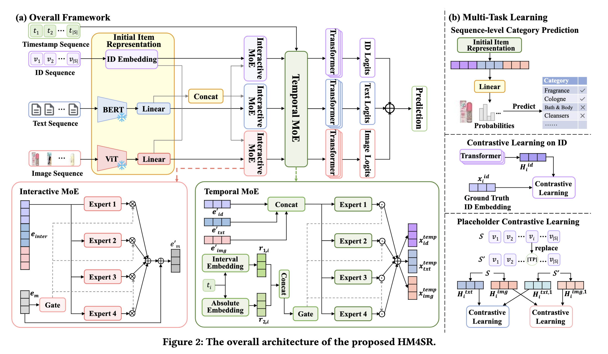

# Hierarchical Time-Aware Mixture of Experts for Multi-Modal Sequential Recommendation

- 发表在：ACM Web Conference 2025（WWW ’25）会议论文集。[论文链接](https://doi.org/10.1145/3696410.3714676) [项目代码](https://github.com/SStarCCat/HM4SR)

- 作者 Shengzhe Zhang、Liyi Chen、Dazhong Shen、Chao Wang、Hui Xiong **南京航空航天大学**、**香港科技大学（广州）**和**香港科技大学**

## 相关工作

Qiang Cui, Shu Wu, Qiang Liu, Wen Zhong, and Liang Wang. 2018. MV-RNN:  A multi-view recurrent neural network for sequential recommendation. IEEE Transactions on Knowledge and Data Engineering 32, 2 (2018), 317–331.

Yupeng Hou, Shanlei Mu, Wayne Xin Zhao, Yaliang Li, Bolin Ding, and Ji-Rong Wen. 2022. Towards universal sequence representation learning for recommender systems. In Proceedings of the 28th ACM SIGKDD Conference on Knowledge Discovery and Data Mining. 585–593.

Jinpeng Wang, Ziyun Zeng, Yunxiao Wang, Yuting Wang, Xingyu Lu, Tianxiang Li, Jun Yuan, Rui Zhang, Hai-Tao Zheng, and Shu-Tao Xia. 2023. MISSRec: Pretraining and transferring multi-modal interest-aware sequence representation for recommendation. In Proceedings of the 31st ACM International Conference on Multimedia. 6548–6557.

Hengchang Hu, Wei Guo, Yong Liu, and Min-Yen Kan. 2023. Adaptive multimodalities fusion in sequential recommendation systems. In Proceedings of the 32nd ACM International Conference on Information and Knowledge Management. 843–853.

Lanling Xu, Zhen Tian, Bingqian Li, Junjie Zhang, Jinpeng Wang, Mingchen Cai, and Wayne Xin Zhao. 2024. Sequence-level Semantic Representation Fusion for Recommender Systems. arXiv preprint arXiv:2402.18166 (2024).

## 问题分析

已有多模态序列模型主要通过相加、拼接，或借助注意力、图网络和 MoE 融合模态。作者认为，这些方法对兴趣相关特征的筛选，以及交互时间所反映的兴趣变化考虑不足。

*多模态信息存在噪声*

商品的图片、描述很丰富，但有些信息和用户购买兴趣无关。

*忽略了显式时间信息*

只知道用户买了哪些商品，但无法区分购买动作发生的时间间隔。

*用户交互的稀疏性*

用户可能只买过几个商品，可用于学习的兴趣信息太少。

## 方法

### 1. 目标

根据用户过去交互过的商品、商品的ID/文本/图像，以及这些交互发生的时间，预测用户最有可能交互的下一件商品。

公式

$$
v=\arg\max_{v\in\mathcal{V}}
P(v_{|S|+1}=v\mid S)
\qquad \text{(1)}
$$

### 2. 初始商品表示

#### 2.1 ID表示

初始化一个商品 ID 嵌入矩阵：

$$
M_{id}\in\mathbb{R}^{|V|\times d}.
$$

#### 2.2 文本特征

公式

$$
f_{txt}
=
\mathrm{BERT}\left(
[[\mathrm{CLS}]_{txt};w_1;w_2;\ldots;w_L]
\right)
\qquad \text{(2)}
$$

#### 2.3 图像特征

公式

$$
f_{img}
=
\mathrm{ViT}\left(
[[\mathrm{CLS}]_{img};p_1;p_2;\ldots;p_N]
\right)
\qquad \text{(3)}
$$

#### 2.4 特征纬度对齐

公式

$$
x_{txt}=W_{txt}f_{txt}+b_{txt}
\qquad \text{(4)}
$$

$$
x_{img}=W_{img}f_{img}+b_{img}
\qquad \text{(5)}
$$

#### 2.5 加入历史交互的位置编码

对于ID嵌入、文本嵌入，以及图像嵌入加入位置信息嵌入。

公式

$$
e_m=x_m+p
\qquad \text{(6)}
$$

### 3. Interactive MoE：交互专家

 ID、文本、图像互相提供补充信息，让模型学习更有用的表示。

#### 3.1 拼接三个模态

公式

$$
e_{inter}=[e_{id};e_{txt};e_{img}]
\qquad \text{(7)}
$$

#### 3.2 将多个专家的输出加权融合

公式

$α_m$用  于控制模态 m上的模态交互强度

$$
x_m^{inter}
=
\alpha_m\sum_{i=1}^{k_1}g_i^m\cdot
\left(W_{i,m}^{inter}e_{inter}+b_{i,m}^{inter}\right)
\qquad \text{(8)}
$$

#### 3.3 门控决定专家权重

公式

$$
g^m=\mathrm{Softmax}(W_{1,m}e_m+b_{1,m})
\qquad \text{(9)}
$$

#### 3.4 残差连接

公式

$$
e'_m=e_m+x_m^{inter}
\qquad \text{(10)}
$$

### 4. Temporal MoE：显式时间专家

使用 **Interval Time**（相邻行为间隔）和 **Absolute Time**（绝对时间戳）进一步调整商品表示。

#### 4.1 计算相邻交互时间间隔

公式

$$
\{a_1,a_2,\ldots,a_{|S|}\}
=
\{0,t_2-t_1,\ldots,t_{|S|}-t_{|S|-1}\}
\qquad \text{(11)}
$$

#### 4.2 计 算间隔的对应位置

为时间间隔维护一个嵌入矩阵$M_t$，根据$pos_i$ 查询相应行得到$r_1,_i$ （第i次交互的时间间隔特征向量）

公式

$$
pos_i=\left\lfloor\mu\log(a_i+1)\right\rfloor
\qquad \text{(12)}
$$

#### 4.3 绝对时间编码

公式

$$
r_{2,i}^{i}
=
\cos\left(\frac{l_i t}{freq^{i/d}}+z_i\right)
\qquad \text{(13)}
$$

#### 4.4 时间门控分配专家权重

公式

$$
g'=\mathrm{Softmax}\left(W_2[r_{1,i};r_{2,i}]+b_2\right)
\qquad \text{(14)}
$$

#### 4.5 拼接 Interactive MoE 输出

公式

$$
e_{temp}=[e'_{id};e'_{txt};e'_{img}]
\qquad \text{(15)}
$$

#### 4.6 时间专家逐维调整商品特征

公式

$$
[x_{id}^{temp};x_{txt}^{temp};x_{img}^{temp}]
=x_{temp}
=
\sum_{i=1}^{k_2}g'_i\cdot
\left(W_i^{temp}\odot e_{temp}\right)
\qquad \text{(16)}
$$

### 5. Transformer 序列建模与预测

为了学习用户兴趣演变，使用transformer编码行为序列中的信息。

#### 5.1 组织三个模态序列

公式

$$
S'_m=\mathrm{Dropout}(\mathrm{LayerNorm}(S_m))
\qquad \text{(17)}
$$

$$
H^m=\mathrm{Transformer}_m(S'_m)
\qquad \text{(18)}
$$

#### 5.2 候选商品匹配分数

公式

$$
\hat{y}_v
=
H^{id}\cdot x_{id}
+H^{txt}\cdot x_{txt}
+H^{img}\cdot x_{img}
\qquad \text{(19)}
$$

### 6. 多任务学习

用户历史交互可能非常稀疏，依靠预测下一件商品，模型获得的监督信号比较有限。

#### 6.1 主推荐交叉熵损失

公式

$$
L_{main}
=
-\sum_{v\in\mathcal{V}}y_v\log(\hat{y}_v)
\qquad \text{(20)}
$$

#### 6.2 CP（Category Prediction）：类别预测

对于护肤品来说，模型可以学习到子类别，比如修复乳、防晒品、保湿品等等商品的语义监督。

公式

$$
\hat{y}^{CP}
=
W_{CP}[x_{id};x_{txt};x_{img}]+b_{CP}
\qquad \text{(21)}
$$
输入是商品的3d纬初始多模态表示，输出是C个类别的预测值。

$$
L_{CP}(v)
=
-\sum_{c\in\mathcal{C}}
\left[
y_c^{CP}\log(\hat{y}_c^{CP})
+(1-y_c^{CP})\log(1-\hat{y}_c^{CP})
\right]
\qquad \text{(22)}
$$
利用二元交叉熵损失来促进多标签类别信息。

#### 6.3 IDCL（Contrastive Learning on ID）：ID 对比学习

用户的历史兴趣表示应该和他真正购买的下一件商品更接近，而与其他不匹配的商品更远。

公式

$$
L_{IDCL}
=
-\log
\frac{
\exp\left(\mathrm{sim}(H_i^{id},x_i^{id})/\tau\right)
}{
\sum_{j=1}^{|B|}
\exp\left(\mathrm{sim}(H_i^{id},x_j^{id})/\tau\right)
}
\qquad \text{(23)}
$$

| 样本 | 用户历史兴趣 | 真实下一件商品 |
| :--- | :---: | ---: |
| A | 护肤品 | 防晒霜 |
| B | 厨具 | 电饭煲 |
| C | 游戏设备 | 键盘 |

#### 6.4 PCL（Placeholder Contrastive Learning）：时间占位符对比学习

作者希望模型能够使用时间特征，并学会时间信息与用户兴趣之间的关联。

随机隐藏历史序列中一部分商品内容，并用对应的时间向量取代它们，然后要求模型仍然能够学出与原序列相近的兴趣表示。
| 位置1 | 位置2 | 位置3 |
| :--- | :---: | ---: |
| 洁面乳 | 面霜 | 防晒霜 |
| 洁面乳 | [TP] | 防晒霜 |

公式

生成时间占位符：
$$
x_{m,i}^{temp}
\leftarrow
W_{P,m}[r_{1,i};r_{2,i}]+b_{P,m}
\qquad \text{(24)}
$$

对比对象：原始序列经过Transformer后的兴趣表示与带有时间占位符的序列经过Transformer后的兴趣表示。
$$
L_{PCL}^{m}
=
-\log
\frac{
\exp\left(\mathrm{sim}(H_i^m,H_i^{m,1})\right)
}{
\sum_{j=1}^{|B|}
\exp\left(\mathrm{sim}(H_i^m,H_j^{m,1})\right)
}
\qquad \text{(25)}
$$

作者把这一任务集中用于加强显式时间信息与文本、图像表示之间的联系。
$$
L_{PCL}
=
\frac{L_{PCL}^{txt}+L_{PCL}^{img}}{2}
\qquad \text{(26)}
$$

### 7. 联合训练与推理

$$
L
=
L_{main}
+\lambda_1L_{CP}
+\lambda_2L_{IDCL}
+\lambda_3L_{PCL}
\qquad \text{(27)}
$$

实现设置：batch size 为 1024，隐藏维度 64，最大历史序列长度 50，Transformer 注意力头数及层数均为 2；$`k_1,k_2\in\{2,4,6,8,12\}`$ 进行搜索；$`\mu=100`$，$`freq=10000`$。

## 结果

在 Amazon Toys、Games、Beauty、Home 四个公开数据集上，NDCG@5/10 和 MRR@5/10 等指标上均取得较强表现。相对最好的多模态基线提升 2.13%—22.9%；相对最好的传统时间感知模型，提升为 13.6%—64.1%。

Toys 数据集 NDCG@5 为 0.0503、MRR@5 为 0.0446，两级 MoE 与三个辅助任务在消融实验中均有贡献，TemporalMoE 的作用最大。

Games数据集上提升较小，作者推测是该数据集的用户行为时间分布比较统一，动态兴趣建模收益比较小。

## 存在的不足（目前能想到的）

- 四个数据集都是Amazon商品数据，缺少跨平台的对照，例如国内的短视频带货平台如抖音、B站、快手、火山等，用户流动性很大，用户兴趣变化速度快，缺少这些平台的验证。
- 模型对时间戳、文本、图像的可用性及可靠性有较高的要求，模态缺失或信息噪声对模型鲁棒性有影响，论文中没有充分展示这些内容。
