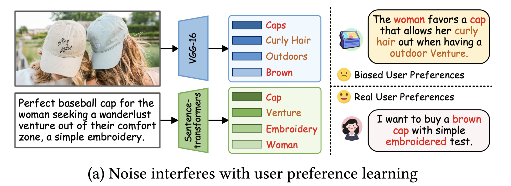

# MLLMRec: A Preference Reasoning Paradigm with Graph Refinement for Multimodal Recommendation

- 发表在：arXiv 预印本 [论文链接](https://arxiv.org/abs/2508.15304v2) [项目代码](https://github.com/Yuzhuo-Dang/MLLMRec)

- 作者 Yuzhuo Dang、Xin Zhang、Zhiqiang Pan、Yuxiao Duan、Wanyu Chen、Fei Cai、Honghui Chen 国防科技大学系统工程学院及电子对抗学院。

## 解决的问题
- 用户表示初始化不准确

多模态推荐中，用户表示如果随机初始化就没有历史偏好信息。如果直接平均已交互物品的图文特征，又容易吸收无关噪声。

- 物品拓扑图中的结构噪声

以固定 K 近邻建立的物品图会保留低相似度错误边，却漏掉“被相近人群共同消费”的物品联系。

## 方法

### 1. 问题分析

用户表示的随机初始化没有利用历史交互，直接聚合历史商品的图文特征则容易带入无关属性。图 1(a) 以帽子为例，对照商品图像与文案中可能出现的卷发、户外等信息，以及用户可能关注的颜色、简单刺绣，说明商品属性与推测的购买偏好并不等同。

物品图还存在低相似度连边和共同受众关系缺失两类问题：

- 固定 KNN 可能保留低相似度近邻。Baby 数据集已有图中，约 12% 的边所连接物品的相似度低于 0.5。作者因此在 Top-K 之外设置相似度阈值，允许每个物品的近邻数少于 K。

- 图文相似度可能漏掉共同受众关系。篮球与护膝的外观和文本不一定相似，却可能被相同人群消费。作者利用两件商品的交互用户集合计算共现关系，补建一张物品图。

### 2. 方法流程

~~~text
商品图像 → 多模态大模型生成购买相关描述
生成描述 + 原商品文本 → 商品多模态描述 → 文本编码器 → 商品向量
用户交互过的商品描述列表 → 大模型归纳偏好画像 → 文本编码器 → 用户向量

商品向量 → 余弦相似度 → Top-K 与阈值筛边 → 语义图
训练交互 → 商品的交互用户集合 → Jaccard 相似度 → 共现图
语义图 + 共现图 → 物品图卷积 → 高阶商品向量

用户向量与高阶商品向量 → MLP 投影 → 内积打分 → BPR 排序训练
~~~

### 3. 商品描述

模型根据商品图像 $i^v$ 和提示词生成描述：

$$
i^s=\operatorname{MLLM}(\mathrm{Prompt}_1,i^v).
$$

提示词要求结合商品领域，描述颜色、材质、风格、功能等可能影响购买决策的属性，并将输出限制为不超过 100 个词的一段文字。随后，模型拼接图片描述 $i^s$ 与原始商品文本 $i^t$：

$$
i^m=i^t\oplus i^s.
$$

该步骤通过提示词筛选需要描述的属性，试图减少无关背景信息，并将图像和文本统一为同一文本编码器可处理的语言材料。它不修改原图像素，也不对图片打分。

### 4. 用户画像

对用户 $u$，模型按历史顺序整理其交互过的物品描述 $i^m$，形成 $\mathrm{List}_u$。MLLM 根据整份列表推理用户偏好，生成不超过 100 个词的自然语言画像：

$$
u^p=\operatorname{MLLM}(\mathrm{Prompt}_2,\mathrm{List}_u).
$$

MLLM 根据用户交互过的商品及其属性，归纳可能的共同偏好和潜在意图，以此代替物品向量的直接均值。生成的画像再由商品侧使用的同一文本编码器转为用户向量 $e_u$。

### 5. 图去噪

模型先用文本编码器将商品描述编码为 $E_I={e_i}$，再计算物品 $a$ 和 $b$ 的余弦相似度：

$$
s_{ab}=\frac{e_a^\top e_b}{\|e_a\|\|e_b\|}.
$$

传统 KNN 为每个物品保留前 $K_s$ 个邻居，即使第 $K_s$ 个近邻的相似度较低，也可能保留该边。模型因此增加相似度阈值 $\alpha$：

$$
\widetilde s_{ab}
=\begin{cases}
1,& b\in\operatorname{TopK}_{K_s}(a)
\ \text{且}\ s_{ab}\geq\alpha,\\
0,& \text{其他情况}.
\end{cases}
$$

如果某个物品只有少数邻居达到阈值，就只保留这些邻居，不补足 $K_s$ 个。

### 6. 共现增强

令 $U_a,U_b$ 分别表示与商品 $a,b$ 交互过的用户集合，模型计算：

$$
c_{ab}=\frac{|U_a\cap U_b|}{|U_a\cup U_b|}.
$$

Jaccard 相似度表示共同用户占两件商品总受众的比例，可用于连接外观不同但受众相近的商品。每个物品保留共现得分最高的前 $K_c$ 个邻居，以 $c_{ab}$ 为边权，得到加权共现矩阵 $\widetilde C$，从而控制图密度。

两张图直接相加：

$$
S^*=\widetilde S+\widetilde C.
$$

融合后的物品边可以来自语义相似、共同受众或两者共同支持。语义图表示内容关系，共现图表示行为关系，两者的数据来源和边权不同。共现图由用户交互构建，但后续卷积作用于物品图，不在用户—物品二部图上执行。

### 7. 图传播

文本编码后的物品向量是初始表示 $E_I^{(0)}=E_I$。设 $D$ 为 $S^*$ 的度矩阵，论文式 11 使用归一化邻居聚合：

$$
E_I^{(\ell)}
=D^{-1/2}S^*D^{-1/2}E_I^{(\ell-1)}.
$$

归一化邻居聚合将邻居信息传给当前商品，同时控制节点度数的影响。模型再对第 0 层至第 $L$ 层的表示求和：

$$
E_I^*=\sum_{\ell=0}^{L}E_I^{(\ell)}.
$$

第 0 层保留商品自身的语义，多层聚合引入高阶邻居信息。图传播采用 LightGCN 形式，各层不额外加入复杂的非线性变换。

随后，用户画像向量 $e_u$ 和聚合后的商品向量 $e_i^*$ 分别经过 MLP，映射到推荐空间。论文使用含 LeakyReLU 的两层投影，得到 $h_u,h_i$，再以内积打分：

$$
\widehat y_{ui}=h_u^\top h_i.
$$

推荐目标用于学习文本语义空间到匹配空间的映射，最终分数不直接取两段生成文本的相似度。

### 8. 排序训练

训练使用三元组 $(u,i^+,i^-)$，正样本为用户已交互的商品，负样本从未观察到交互的商品中随机抽取。模型采用 BPR 损失：

$$
L_{\mathrm{BPR}}
=-\sum_{(u,i^+,i^-)}
\log\sigma(\widehat y_{u i^+}-\widehat y_{u i^-}).
$$

BPR 提高正样本相对负样本的得分，使投影后的用户画像和物品表示适合推荐排序。预测时按得分降序输出 Top-K 商品。负样本表示尚未观察到交互，不等于用户明确不喜欢。

## 结果

在 Amazon Baby、Sports、Clothing 三个数据集上，相对各自最强基线，Recall@20 分别提升 27.57%、16.39%、17.50%；NDCG@20 分别提升 30.15%、17.94%、18.13%。
消融实验得出偏好推理、图去噪、图增强、物品图卷积及图文模态均有贡献，其中移除偏好推理的损失最大；同时还测试了图精炼策略在其他推荐模型上的可插拔性。

## 存在的不足（目前能想到的）
- 图像描述和用户画像依赖多模态大语言模型，这些描述的准确性不可靠，比如商品属性缺失，识别错误（比如在旅游业中的应用中把黄鹤楼说成岳阳楼），同时在用户流动性大的电商平台中，每来一个新用户都要进行相关文本的推理，这个性能和实效性如何？有待商榷。
- 作者只在Amazon商品数据集上进行测试，缺少跨平台的对照。

