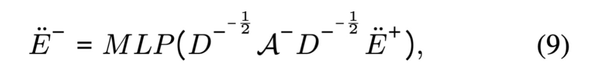
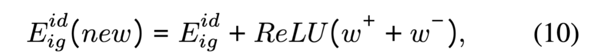

# Sign-Aware Multimodal Graph Recommendation

- 发表在：Proceedings of the AAAI Conference on Artificial Intelligence 2026年3月14日 [论文链接](https://doi.org/10.1609/aaai.v40i18.38547)

- 作者：Yahong Lian、Haotian Tian、Chunyao Song、Tingjian Ge。前三位来自南开大学，Tingjian Ge 来自马萨诸塞大学洛厄尔分校。

- [作者代码](https://github.com/DRec4AI/SiMGR2025)；[本地复现记录](../CodeReproduction/SiMGR/README.md)。

# Question

结论是用户买过一个产品不代表他喜欢这个产品。

比如用户买了一双跑鞋 A，评价 5 星，买了一个头盔 B，评价 1 星。虽然用户与头盔发生了交互，但不能直接把这条记录当作喜欢的证据。差评仍然有用，它可以帮助模型学习用户不满意什么。

如果系统只记录“买过还是没买过”，跑鞋 A 和头盔 B 就都会被记成“买过”。这种做法没有充分考虑高评分交互与低评分交互之间的语义差异，高评分表示用户偏好，而低评分明确表达不满意。忽视负反馈的含义，可能限制推荐性能。

本文做的是多模态 Top-K 商品推荐：根据用户的历史交互、评分和商品图文信息，对候选商品打分排序。

这些是作者提出本项工作的出发点，并且做了对比实验。


绿色柱子：将所有用户评价1-5星都当作正向交互

蓝色柱子：只保留4-5星当作正向交互

紫色柱子：LSGRec(Liu 等 2025a)纳入负反馈后的得分

图 1 的纵轴是 NDCG@20，越高表示前 20 个推荐结果的排序质量越好。比较同一个模型的蓝色和绿色柱子，可以看出把低评分混进正反馈可能损害效果；LSGRec 的紫色柱子则说明，保留并区分负反馈可以比直接删除更有效。

通过对比实验，作者认为区分正负反馈有帮助，使用商品的图文信息也有帮助，将两种方法结合起来时会面临下面三种挑战。

### 商品的图文信息与符号交互结构怎么融合

图片和文本描述的是商品内容，正负交互表达的是用户对商品的满意度，简单的拼接或相加不一定有效，反而可能降低推荐性能。

### 统一评分边界不适用所有用户

有些用户习惯打高分，三星对他们而言可能就是差评；而对一些评分严格的用户来说，三星已经算相对满意。因此需要根据用户的评分习惯，分别确定正负反馈的划分界限。

### 把交互图拆分成正负子图之后会加剧稀疏性

进一步拆分后，部分节点在某个子图中可能只剩很少的邻居，甚至没有邻居。作者考虑补充一些推测出来的连接，改善信息传播条件。这里减少的是每个子图单独可用的边，并不是原始交互记录被删除了。

# Idea

针对这些挑战，作者提出了三个模块：SGA 负责利用正负反馈，PST 负责确定正负反馈的划分界限，APFI 负责补充稀疏的反馈关系。

### SGA（Signed Graph Augmentation）

先固定评分阈值 $`\delta = 3`$

4、5 分进入正反馈图 $`\mathcal{G}^+`$

1、2、3 分进入负反馈图 $`\mathcal{G}^-`$

#### 在正图上进行LightGCN传播

```math
\dot{E}^{+(l+1)}
=
(D^+)^{-\frac{1}{2}}
A^+
(D^+)^{-\frac{1}{2}}
\dot{E}^{+(l)}
\qquad \text{(5)}
```

传播完成后对各层取平均

```math
\ddot{E}^+
=
\frac{1}{L+1}
\sum_{l=0}^{L}\dot{E}^{+(l)}
\qquad \text{(6)}
```

$`A^+`$ 是正图的邻接矩阵，$`D^+`$ 是正图的度矩阵。初始表示来自可学习的用户、商品 ID 向量；传播两层时，把第 0、1、2 层一起平均，得到 $`\ddot{E}^+`$。公式（7）、（8）是把矩阵计算展开到单个用户和商品。

用户从正反馈邻居收集向量，根据双方在正图中的度分配权重，再求和。商品也以同样方式从相连用户那里收集信息

```math
\dot{\mathbf{e}}_u^{+(l+1)}
=
\sum_{i\in\mathcal{N}_u^+}
\frac{1}{\Gamma_{ui}}
\dot{\mathbf{e}}_i^{+(l)}
```

```math
\Gamma_{ui}
=
\sqrt{|\mathcal{N}_u^+|\,|\mathcal{N}_i^+|}
```

#### 将正反馈表示沿负图传播，再进行变换。

直接使用刚得到的 $`\ddot{E}^+`$ 作为输入，节点先获得正反馈信息，再通过负反馈关系收集其他节点的这些表示。



作者在负图上进行一次图传播，然后加上一个 MLP，MLP 接收聚合后的向量，通过可学习的变换产生负反馈表示。

这样处理是因为负反馈关系具有异配性，MLP 用来进一步变换负邻居聚合的信息。

```math
\text{正反馈表示}
\longrightarrow
\text{负图传播}
\longrightarrow
\text{MLP}
\longrightarrow
\text{负反馈表示}
```

#### 让正负反馈增强原有交互表示

模型保留完整交互图的表示 $`E_{\mathrm{ig}}^{\mathrm{id}}`$，再将正、负表示加权后补充进去：



```math
w^+=a[0]\odot\ddot{E}^+,\qquad
w^-=a[1]\odot\ddot{E}^-
```

注意力权重 $`a[0]`$、$`a[1]`$ 根据各节点的正负表示计算，经 softmax 后和为 1。ReLU 对每个坐标保留正值，把负值变成 0。

得到增强后的交互表示后，再与图文分支的表示融合：

```math
E^*=E_{\mathrm{ig}}^{\mathrm{id}}(\mathrm{new})+\widetilde{E}
```

图文分支先把预提取的图片、文本特征投影到相同维度，再根据交互商品聚合用户的模态特征，经过图传播和模态融合得到 $`\widetilde{E}`$。最终用用户、商品向量的内积打分。

### PST（Personalized Sign Threshold）

PST 根据每个用户已有的评分计算阈值，用来替代所有用户共用的 $`\delta=3`$。

先用 $`M_{ui}=\mathbb{I}(R_{ui}>0)`$ 标记哪些位置有评分，再计算该用户的评分均值和标准差：

```math
\mu_u=\frac{\sum_iR_{ui}M_{ui}}{\sum_iM_{ui}},\qquad
\varepsilon_u=\sqrt{\frac{\sum_i(R_{ui}-\mu_u)^2M_{ui}}{\sum_iM_{ui}}}
\qquad \text{(13)}
```

没有交互的位置虽然在矩阵里记为 0。

用户的最终阈值是：

```math
\delta_u=\nu\mu_u-(1-\nu)\varepsilon_u
\qquad \text{(14)}
```

$`\nu`$ 是控制均值和标准差影响的超参数。比如某用户均值为 4、标准差为 1，取 $`\nu=0.8`$，得到的阈值就是 $`0.8\times4-0.2\times1=3`$。

### APFI（Adaptive Pseudo Feedback Injection）

APFI 利用商品的图文相似度，为正负图补充伪反馈边，缓解拆图后的稀疏性。

先按商品的交互次数从少到多排序，把最少的 $`\xi`$ 比例划为长尾商品，其余划为头部商品：

```math
N_{\mathrm{tail}}=\lfloor\xi N\rfloor
```

论文使用 $`\xi=0.1`$，对应交互最少的 10% 商品进入长尾集合。

随后，分别计算商品图片向量和文本向量之间的余弦相似度，再逐元素相乘：

```math
s_{ij}^m=\frac{(h_i^m)^\top h_j^m}{\|h_i^m\|\|h_j^m\|},\quad m\in\{v,t\},
\qquad S^f=S^v\odot S^t\qquad \text{(16)}
```

对于每个用户，取出其历史交互商品对应的相似度行，与未交互商品比较。这个历史集合并没有在定义中限定为只有高评分商品。两类补边策略如下：

| 候选商品         | 补边依据                                     |     |
| ---------------- | -------------------------------------------- | --- |
| 未交互的长尾商品 | 与历史商品的图文内容相似，可能只是缺少曝光   |     |
| 未交互的头部商品 | 与历史商品的图文内容差异较大，可能不符合兴趣 |     |

论文通过 Top-Q 和阈值筛选候选，设定 $`Q=20`$。它先将历史商品与候选商品之间的相似度展开后选择。

正边采用高相似度候选，再用 $`\zeta^+`$ 筛选；负边通过相似度取负后选候选，再用 $`\zeta^-`$ 筛选。

选出的伪边分别加到原来的正负交互矩阵：

```math
R_b^+\leftarrow R_b^++\widetilde{R}^+,\qquad
R_b^-\leftarrow R_b^-+\widetilde{R}^-
```

# Experiment

### 数据集和实验设置

作者使用 Amazon 的 Baby、Sports、Electronics 三个数据集。

| 数据集      | 用户数 | 商品数 | 交互数  | 密度   |
| ----------- | ------:| ------:| -------:| ------:|
| Baby        | 19,445 | 7,050  | 160,792 | 0.117% |
| Sports      | 35,598 | 18,357 | 296,337 | 0.045% |
| Electronics | 20,247 | 11,589 | 347,393 | 0.148% |

模型基于 MMRec 框架实现，向量维度 64，batch size 为 2048，学习率 0.001，用户—物品图传播 2 层，使用 Xavier 初始化和 Adam 优化。验证集 Recall@20 连续 20 轮没有提升就提前停止，论文实验设备为 NVIDIA RTX 3090。

### 消融实验

图 3 比较 Base、Base+SGA、去掉 APFI、去掉 PST，以及完整 SiMGR。加入 SGA 后指标整体提高，完整模型表现最好。

# Result

### 论文结果

| 方法     | Baby R@20  | Baby N@20  | Sports R@20 | Sports N@20 | Electronics R@20 | Electronics N@20 |
| -------- | ----------:| ----------:| -----------:| -----------:| ----------------:| ----------------:|
| MF-BPR   | 0.0557     | 0.0240     | 0.0634      | 0.0288      | 0.0662           | 0.0306           |
| LightGCN | 0.0750     | 0.0322     | 0.0846      | 0.0386      | 0.0791           | 0.0374           |
| SiReN    | 0.0678     | 0.0296     | 0.0750      | 0.0334      | 0.0548           | 0.0326           |
| SiGRec   | 0.0770     | 0.0329     | 0.0781      | 0.0350      | 0.0538           | 0.0308           |
| LSGRec   | 0.0715     | 0.0323     | 0.0849      | 0.0388      | 0.0536           | 0.0315           |
| MGCN     | 0.0984     | 0.0436     | 0.1114      | 0.0504      | 0.0879           | 0.0421           |
| BM3      | 0.0845     | 0.0369     | 0.0968      | 0.0441      | 0.0792           | 0.0376           |
| FREEDOM  | 0.1001     | 0.0438     | 0.1096      | 0.0490      | 0.0881           | 0.0409           |
| LGMRec   | 0.0967     | 0.0441     | 0.1064      | 0.0484      | 0.0866           | 0.0416           |
| DiffMM   | 0.0796     | 0.0349     | 0.1014      | 0.0454      | 0.0871           | 0.0394           |
| TMLP     | 0.0973     | 0.0438     | 0.1111      | 0.0500      | 0.0854           | 0.0403           |
| SiMGR    | **0.1052** | **0.0471** | **0.1160**  | **0.0526**  | **0.0904**       | **0.0428**       |

### 本地复现结果

本地已经跑通 Sports，以下为运行日志，时间： **2026-10-21 16:07:09**，seed 为 **999**。记录 BEST 部分。

| 数据划分    | R@10   | R@20   | N@10   | N@20   |
| ----------- | ------:| ------:| ------:| ------:|
| Valid       | 0.0661 | 0.0982 | 0.0364 | 0.0445 |
| Test        | 0.0671 | 0.1001 | 0.0377 | 0.0462 |
| 论文 Sports | 0.0782 | 0.1160 | 0.0428 | 0.0526 |

| K   | Recall@K | NDCG@K | Precision@K | MAP@K  |
| --- | --------:| ------:| -----------:| ------:|
| 5   | 0.0445   | 0.0303 | 0.0098      | 0.0249 |
| 10  | 0.0671   | 0.0377 | 0.0074      | 0.0279 |
| 20  | 0.1001   | 0.0462 | 0.0055      | 0.0301 |
| 50  | 0.1590   | 0.0581 | 0.0035      | 0.0320 |

本地跑了3次，记录的是最高值，但还是没有达到论文中的分数，现在对原理理解还不够，想不到怎么优化。

# Limitation

1. 该工作依赖用户的真实评价，现在电商系统存在泛滥且普遍的刷好评操作，另外相当一部分用户群体只有在不喜欢商品的时候才会写评价而且是差评，如果觉得商品没啥问题甚至连确认收货都忘记点，系统默认好评。所以有价值的真实评价怎么界定？

2. **伪反馈可能引入错误。** 我有点无法理解构造伪边的操作，用户对头部曝光产品长期没有交互就构造伪负边我认为不太合理，没有交互不代表可能不喜欢，现在没交互，未来可能有交互，只是现在不需要。对于相似的同类物品没有交互作者认为是缺少曝光，这种考虑有点片面，拿羽绒服举例，单纯的因为款式过时了这种情况就会造成没有交互。

这篇文章给我的主要启发是，交互记录不能一律当成喜欢，低评分也可以成为有用的信息。如果要在这篇工作的基础上继续优化，我觉得要考虑如何正确使用这些评价的正负反馈，而不是单纯的增加图的复杂度。
